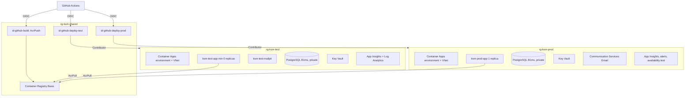

# Infrastructure architecture (Azure)

> **Current state (November 2026): only PROD is provisioned.** New Azure subscriptions are limited to one Container Apps environment per region (`ManagedEnvironmentCount = 1` in Poland Central), so the cloud TEST environment was removed to make room for PROD. TEST stays fully defined in Bicep behind `DEPLOY_TEST_ENVIRONMENT=true`. Re-enable it after the quota is raised through an Azure support request (Quotas → Container Apps → Managed Environment Count). Until then, pre-production verification is CI's E2E suite running against the exact image that is deployed, followed by approval-gated deployment and production smoke tests.

Everything is defined in [`infra/`](../../infra) as Bicep and deployed at subscription scope by `infra/scripts/deploy-infrastructure.sh`.

## Resources per environment

| Resource | TEST | PROD | Notes |
|---|---|---|---|
| Container App (app) | 0.5 vCPU / 1 GiB, **0–1 replicas** | 0.5 vCPU / 1 GiB, **exactly 1 replica** | PROD must stay up: the scheduler and outbox worker run in-process. TEST scales to zero when idle. |
| Container App (Mailpit) | 0.25 vCPU / 0.5 GiB, 1 replica | – | UI protected by basic auth; SMTP port internal only. |
| PostgreSQL Flexible Server | Burstable B1ms, 32 GB | Burstable B1ms, 32 GB | Private VNet access only, TLS required. Backups: 7 days (TEST), 14 days (PROD). |
| Key Vault | RBAC, soft delete 7 days | RBAC, soft delete 90 days, purge protection | The app reads secrets with its managed identity. |
| Log Analytics | 30 days, 0.2 GB/day cap | 30 days, 1 GB/day cap | Caps prevent runaway telemetry costs. |
| Application Insights | workspace-based | workspace-based + availability test | Java agent 3.7.10 baked into the image (checksum verified). |
| Communication Services Email | – | Azure-managed domain at first | Custom domain added once DNS is ready (see production-deployment.md). |
| Alerts | – | restarts, 5xx, DB CPU, DB storage, availability | Email action group. |

The registry is shared on purpose: the image built once on `main` is promoted from TEST to PROD by digest.

## Estimated monthly cost

Prices are list prices for EU regions as of late 2026, **not verified in the Azure pricing calculator for Poland Central**. Check them before relying on these numbers.

| Item | TEST | PROD | Shared |
|---|---|---|---|
| PostgreSQL B1ms compute + 32 GB storage | ≈ 16 USD (≈ 4 USD when the server is stopped) | ≈ 16 USD | – |
| Container Apps (consumption, mostly idle) | ≈ 1–4 USD (scale to zero, Mailpit ≈ 3 USD) | ≈ 8–15 USD | – |
| Container Registry Basic | – | – | ≈ 5 USD |
| Log Analytics / App Insights (low volume) | < 1 USD | ≈ 1–3 USD | – |
| Key Vault, private DNS zone, ACS email | < 1 USD | ≈ 1 USD | – |
| **Total** | **≈ 20–25 USD** | **≈ 27–35 USD** | **≈ 5 USD** |

Cost levers that do not reduce security:

- Stop the TEST database outside test sessions: `az postgres flexible-server stop -g rg-ksm-test -n <server>`. Azure restarts it automatically after 7 days.
- Lower the TEST log cap.
- Delete the whole `rg-ksm-test` after the season and recreate it from Bicep.
