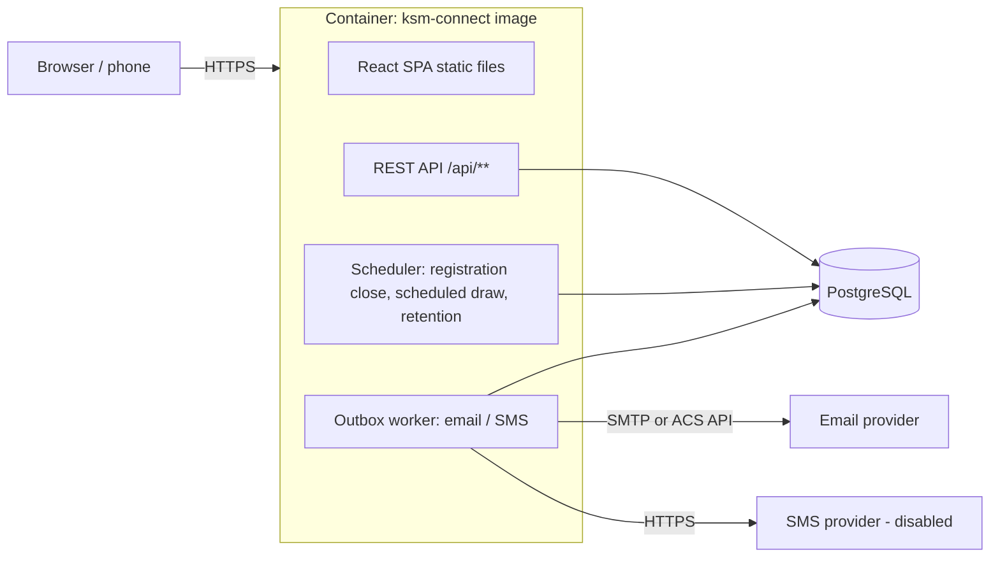

# System architecture

KSM Connect is a modular monolith: one Spring Boot application that also serves the compiled React single-page application, plus one PostgreSQL database. There is no message broker, cache or second service. The notification outbox and the scheduler run inside the same process and use PostgreSQL for coordination.

## Why the frontend is served by the backend

The original plan used Azure Static Web Apps for the frontend. It was replaced by serving the built SPA from the backend container because:

- **Cookies:** the session cookie and the API share one origin. Different `*.azurestaticapps.net` and `*.azurecontainerapps.io` hosts would make the session a third-party cookie, which Safari and Chrome block, so login would break until a custom domain existed.
- **One artifact:** a single image contains the exact frontend and backend that were tested, and the same image is promoted from TEST to PROD. There is no per-environment frontend build.
- **No CORS surface,** and one place to set security headers (CSP, HSTS, frame denial).
- **Fewer resources** to operate for a single maintainer.

Hashed assets under `/assets/**` are served with `Cache-Control: immutable` (1 year). `index.html` is served with `no-cache`, so a new release is picked up on the next navigation.

## Modules

See the module table in the [README](../../README.md#architecture). The most security-relevant flows are:

- **Drawing:** one transaction that locks the event row, generates and validates a derangement, inserts assignments and outbox rows, and marks the event `DRAW_COMPLETED`. Database triggers guarantee immutability and completeness.
- **Notifications:** outbox rows reference only participant IDs. Message content is built at send time, and failures retry with backoff without touching the drawing.
- **Assignments:** readable only by the giver through `/api/events/{id}/assignment`. No endpoint returns the mapping.

## Environment-specific behaviour

| Setting | LOCAL | TEST | PROD |
|---|---|---|---|
| Spring profile | default | `prod` | `prod` |
| Email | Mailpit (Docker) | Mailpit (Container App, password protected) | Azure Communication Services (managed identity) |
| SMS | disabled | disabled | disabled (no provider contract yet) |
| API docs (Swagger) | on | on | off |
| Logs | plain text | ECS JSON | ECS JSON |
| Telemetry | none | Application Insights agent | Application Insights agent |
| Banner | none | "ŚRODOWISKO TESTOWE" | none |
