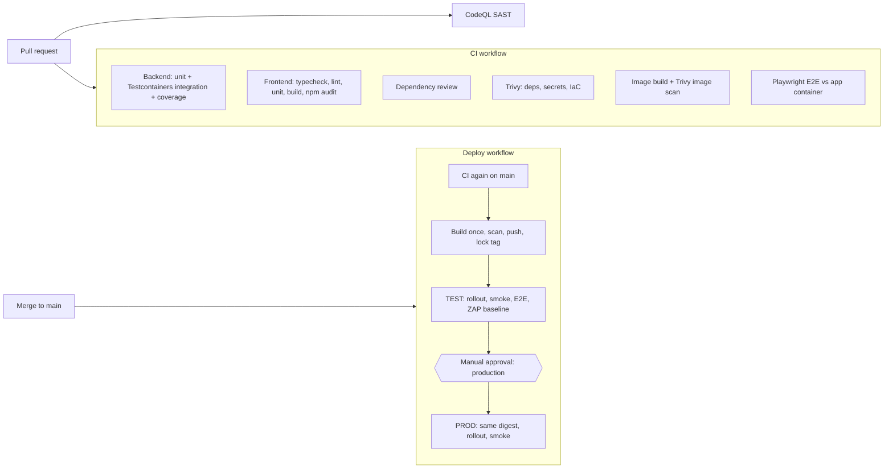

# CI/CD

## Workflows

| File | Trigger | Purpose |
|---|---|---|
| `.github/workflows/ci.yml` | pull request, called by Deploy | All quality and security gates. Required checks for merging. |
| `.github/workflows/codeql.yml` | pull request, push to main, weekly | Static analysis for Java and TypeScript (`security-and-quality` queries) |
| `.github/workflows/deploy.yml` | push to main, manual | Build → TEST → approval → PROD |

## Artifact traceability

- **Tagging:** the image is built once per commit and tagged with the full commit SHA. The tag is locked against overwrite and deletion (`az acr repository update --write-enabled false`).
- **Deploying by digest:** TEST and PROD are deployed with `registry/ksm-connect@sha256:…`, so PROD runs byte-for-byte what passed in TEST.
- **Labelling:** the image carries the `org.opencontainers.image.revision` label, and the job summary links the digest to the commit.

## Security tooling and why each one

| Tool | Covers | Where |
|---|---|---|
| Trivy (fs) | Vulnerable dependencies (Maven, npm), committed secrets, Dockerfile/Bicep misconfiguration | CI |
| Trivy (image) | OS and Java library CVEs in the final image | CI, before every push |
| Dependency Review | Blocks PRs that add dependencies with known high-severity CVEs | CI on pull requests |
| CodeQL | SAST: injection, XSS, unsafe deserialization, etc. | Separate workflow |
| npm audit | Production npm dependencies | CI |
| OWASP ZAP baseline | Passive DAST against TEST: headers, cookies, info leaks. It never attacks. | Deploy → TEST |
| Dependabot | Weekly grouped updates for Maven, npm and Actions | Repository |
| Playwright + MockMvc tests | AuthN/AuthZ, IDOR, CSRF, brute force, XSS rendering, SQL-injection inputs | CI |

Base images are not managed by Dependabot. They use floating patch tags (`25-jre-alpine`, `24-alpine`), so every build picks up OS patches, and Trivy fails the build if a fixable HIGH/CRITICAL CVE remains.

## One-time GitHub configuration

Done once after infrastructure is provisioned. The commands are in [production-deployment.md](production-deployment.md#4-configure-github).

- **Repository variables:** `AZURE_TENANT_ID`, `AZURE_SUBSCRIPTION_ID`, `AZURE_BUILD_CLIENT_ID`, `ACR_NAME`, `ACR_LOGIN_SERVER`.
- **Environment `test` variables:** `AZURE_CLIENT_ID`, `RESOURCE_GROUP`, `APP_NAME`, `APP_URL`, `MAILPIT_URL`.
- **Environment `test` secrets:** `MAILPIT_PASSWORD`, `E2E_ADMIN_EMAIL`, `E2E_ADMIN_PASSWORD`.
- **Environment `production` variables:** `AZURE_CLIENT_ID`, `RESOURCE_GROUP`, `APP_NAME`, `APP_URL`. Required reviewer: the maintainer. Deployment branch: `main` only.
- **Branch ruleset on `main`:** require a PR and these checks: `backend`, `frontend`, `security-scan`, `container`, `e2e`, `dependency-review`, `analyze (java-kotlin)`, `analyze (javascript-typescript)`.
